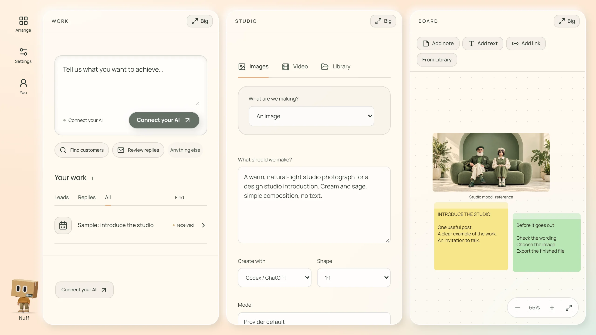
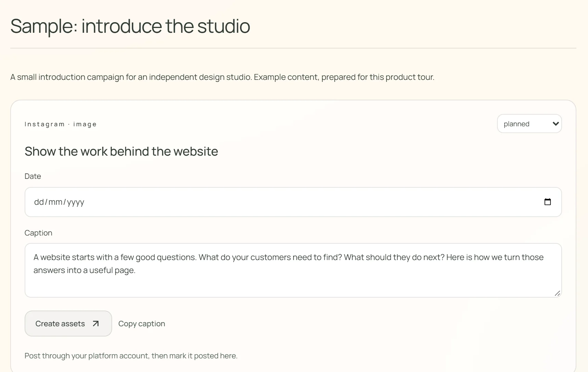
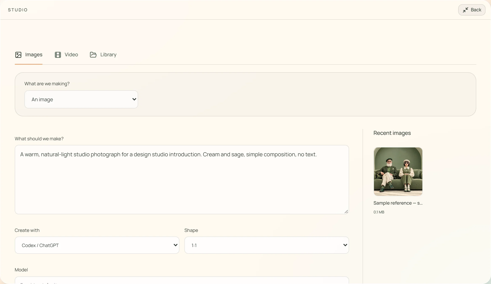
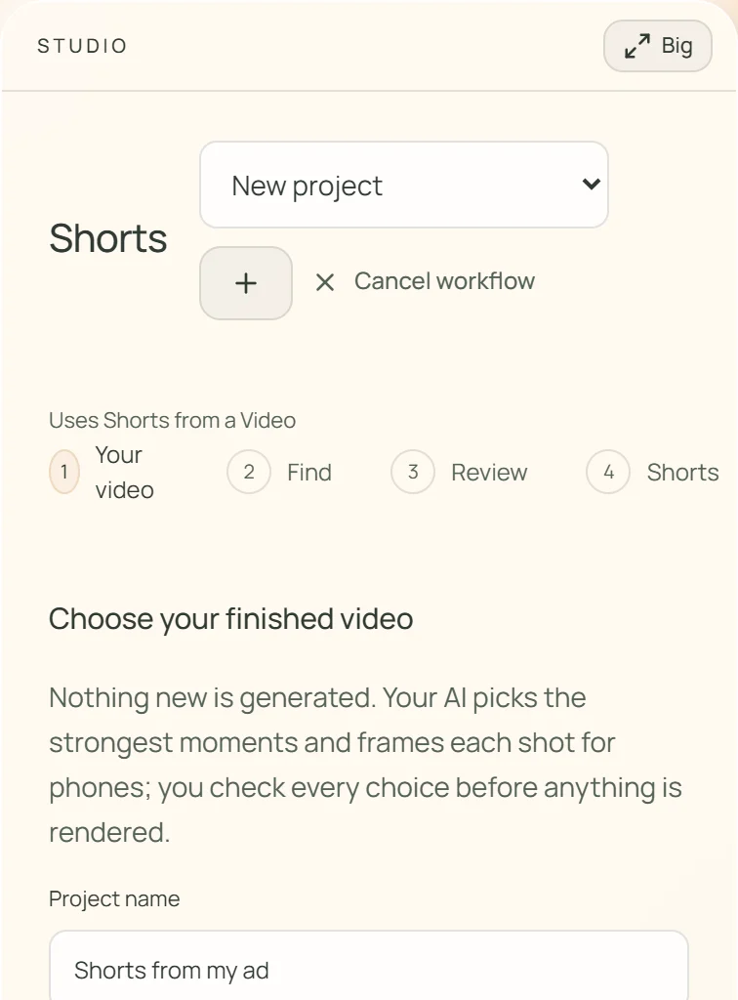
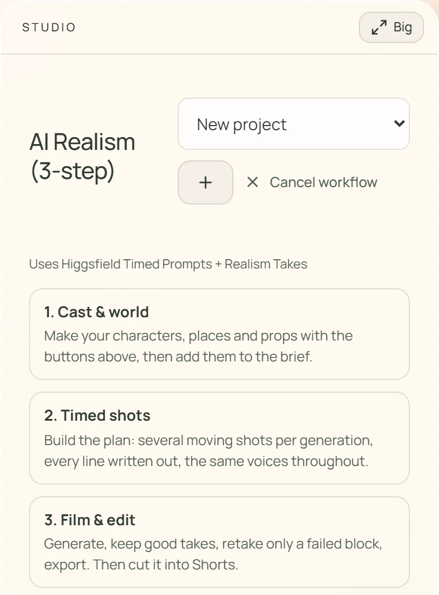

# Citadel by heynuff

Find customers and make content in one place. Customers connect their own ChatGPT or Claude, and Citadel runs it through ready-made workflows. A person approves every step that can't be undone.

**Live at [app.heynuff.com](https://app.heynuff.com)** (free plan, no card) · **[4-minute walkthrough](https://youtu.be/EGWpMdsa0-A)**

> This repository is a showcase. Citadel's source code is private and isn't published here.

## What it does

- **Find customers.** Describe who you want to work with. Citadel finds real businesses, explains why each one fits, and drafts the first email for you to review.
- **Make content.** Plan posts, then make the images and captions.
- **Make video.** Commercial ads, motion explainers and an AI Realism workflow for filmed scenes, with every paid generation quoted before it runs.
- **Shorts.** Turn a finished video into shorts: it finds the cuts, picks the strongest moments and reframes each shot for phones.
- **Nuff.** A built-in helper that can operate the app for you.

| | |
|---|---|
|  |  |
|  |  |

## How it's built

- **Front end:** React, TypeScript, Vite, Tailwind, three.js
- **Back end:** Node.js, Fastify, SQLite
- **Hosting:** Cloudflare, with staging, production and rollback
- **Media:** ffmpeg (cut detection, framing, loudness), HyperFrames for editable video
- **AI:** the customer's own ChatGPT or Claude. Every workflow returns a typed response, and the app falls back to another model if one is refused.
- **Agent:** Nuff works the app through tool calls, using a map of the app that updates itself as features are added.
- **Safety:** nothing is sent, generated or paid for until a person approves the exact request and its price.

## Built by

[Jack Brizuela](https://github.com/jackbrizuela) at [heynuff.com](https://heynuff.com).

© 2026 heynuff. All rights reserved.
